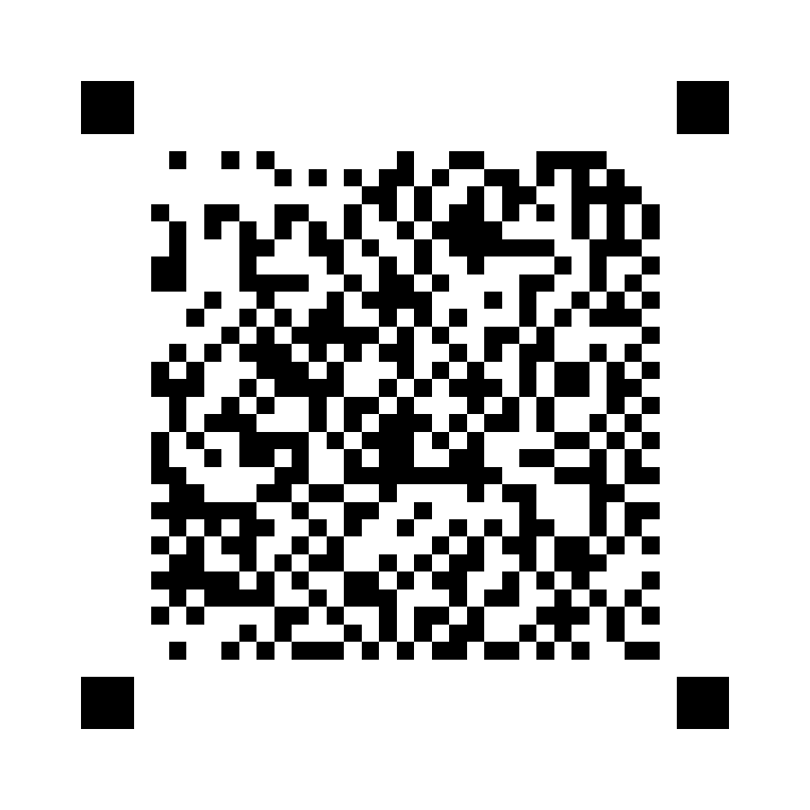
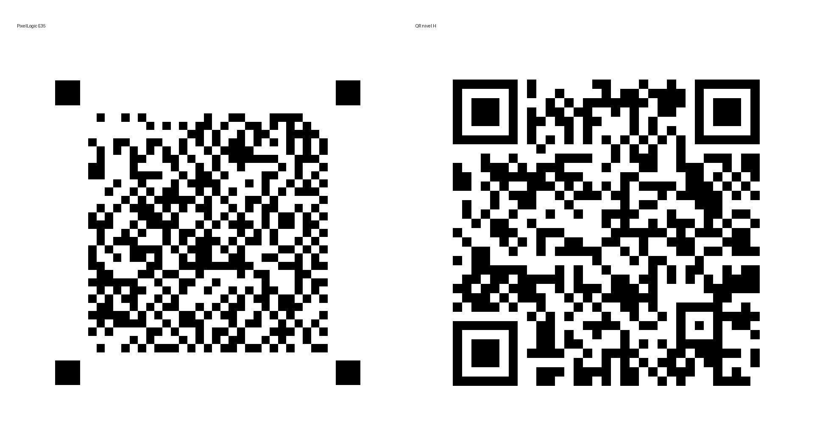

# PixelLogic E35 — generador y lector experimental de códigos visuales

**PixelLogic** es un formato experimental de matriz binaria, **distinto de QR**, con cuatro localizadores cuadrados distribuidos, detección de geometría y protección de datos. Este repositorio contiene el **motor E35**, un generador, un lector de imágenes/fotografías y una interfaz de escritorio con comparación opcional frente a QR.

> **Estado:** prototipo experimental funcional, **no** estándar, **no** reemplazo de QR. Los lectores QR convencionales **no** interpretan símbolos PixelLogic. Las fotografías difíciles y oclusiones pueden fallar. No utilizar para información crítica.

## Ejemplo: «Laboratorio de lo Imposible»



Archivo generado mediante el motor real E35; verificado automáticamente con el lector del mismo proyecto. El texto exacto codificado es `Laboratorio de lo Imposible` (UTF-8, respetando mayúsculas y espacios). **No confundir con ilustraciones generadas por IA:** estas no son códigos necesariamente legibles.



## Requisitos

- Python **3.10+**, Windows 10/11, Linux o macOS para CLI.
- Interfaz gráfica con `tkinter` (normalmente incluida en Python de Windows; en Linux puede requerir `python3-tk`).
- Dependencias Python: `numpy`, `opencv-python`, `Pillow`, `qrcode`.

## Instalación rápida en Windows (PowerShell)

```powershell
git clone https://github.com/TU-USUARIO/pixellogic.git
cd pixellogic
py -3 -m venv .venv
.\.venv\Scripts\Activate.ps1
python -m pip install -r requirements.txt
python -m unittest discover -s tests -v
python studio.py
```

**Importante:** sustituye `TU-USUARIO` por tu usuario real de GitHub después de crear el repositorio. Si PowerShell impide activar el entorno, llama a `.\.venv\Scripts\python.exe` directamente en cada comando (no cambies la política de seguridad solo por ejecutar esto).

También puedes ejecutar `INSTALAR.bat` y luego `INICIAR.bat`, aunque el entorno virtual anterior es más reproducible.

## Terminal: generar códigos

```powershell
python studio.py generar --texto "Laboratorio de lo Imposible" --salida outputs --pixels 900 --nivel H
```

Archivos: `outputs/pixellogic.png`, `outputs/qr_H.png`, `outputs/comparacion.png`. QR-H es solo referencia de comparación.

## Terminal: descifrar/leer

```powershell
python studio.py leer --imagen outputs/pixellogic.png
python studio.py leer --imagen outputs/qr_H.png
python studio.py lote --carpeta outputs --salida lecturas.csv
```

**Nota:** aquí «descifrar» significa **decodificar**, no descifrado criptográfico. PixelLogic **no cifra ni oculta secretamente el mensaje**.

## Interfaz

```powershell
python studio.py
```

Introduce un mensaje, selecciona corrección QR-M/Q/H para el símbolo de referencia y una resolución de salida. Usa **Generar PixelLogic + QR**, **Abrir imagen/foto** y **Leer con ambos**.

## Verificación

```powershell
python -m unittest discover -s tests -v
```

Las pruebas verifican símbolos limpios reales y lectores independientes PixelLogic/QR. **No garantizan** recuperación ante cualquier perspectiva u oclusión.

## Arquitectura

- `studio.py`: CLI, interfaz Tkinter, generador de comparación QR y lector dual.
- `core/pixellogic.py`: API para crear y leer PixelLogic E35.
- `core/e31.py`: diseño del símbolo con localizadores distribuidos.
- `core/e32.py`, `core/e35.py`: lector óptico y recuperación proyectiva.
- `core/e22.py`, `core/e23.py` y auxiliares: codificación, redundancia y recuperación.
- `tests/`: pruebas reproducibles.
- `docs/FORMATO.md`: descripción del formato y sus límites.
- `docs/INVESTIGACION.md`: resultados comparativos e interpretación.
- `docs/PUBLICAR_EN_GITHUB.md`: publicación paso a paso.

## Evidencia y límites

En una batería histórica de 30 oclusiones sintéticas por longitud se observaron PixelLogic vs QR-H: 4 B (30/30 vs 18/30), 18 B (30/30 vs 18/30), 102 B (11/30 vs 28/30). **No son pruebas que se ejecuten al instalar este repositorio**, ni demuestran superioridad general: no están igualados los niveles de redundancia efectivos ni los lectores. No hay garantía de interoperabilidad ni estandarización.

La integración experimental de reglas de autómatas celulares **no** se incluye en E35 porque no mejoró consistentemente la lectura. El código publicado es el formato E35 conservado.

## Licencia

MIT; revisa autoría de las contribuciones antes de la publicación definitiva, especialmente si añades recursos de terceros. Código experimental, sin garantías.
